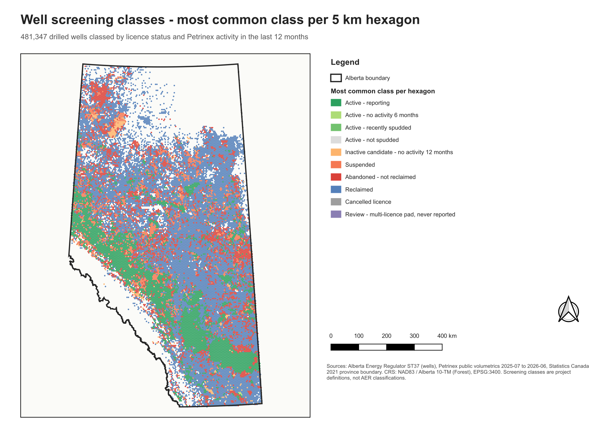
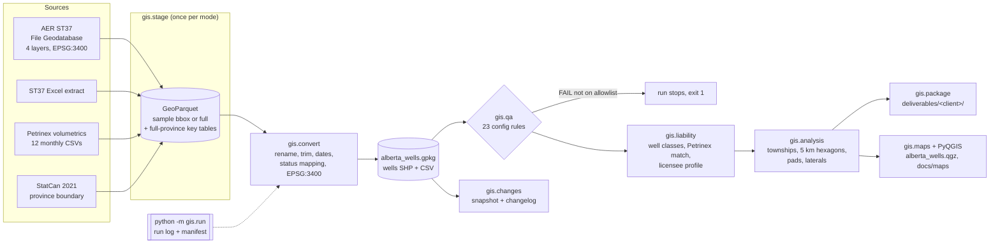
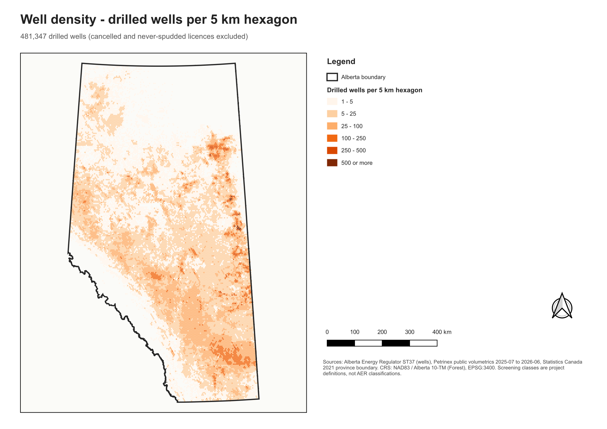
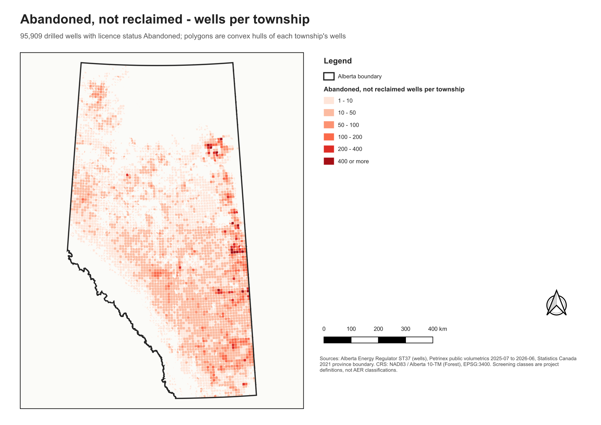
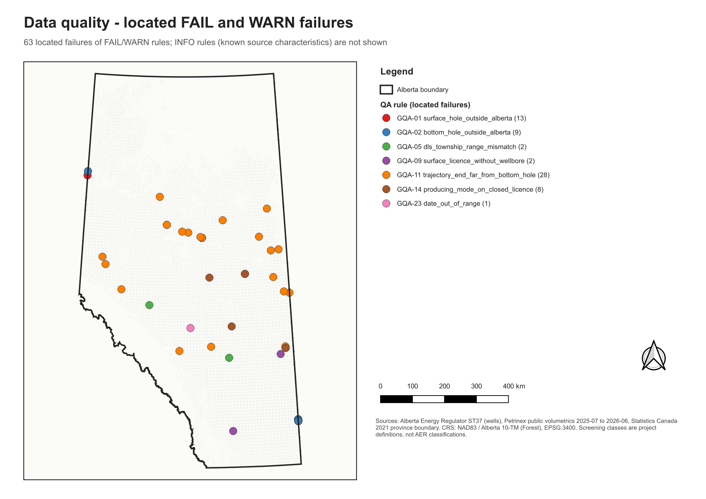
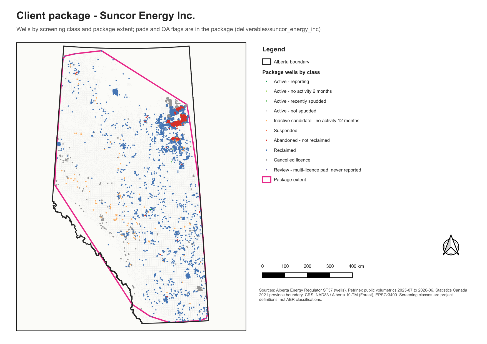

# Alberta Well Production Analytics Platform

Two tracks built on the same public data:

- **Fabric pipeline** (`notebooks/`): Petrinex monthly production and AER well data through a Bronze / Silver / Gold
  medallion architecture in a Microsoft Fabric Lakehouse, feeding a Power BI semantic model.
- **GIS track** (`gis/`, this README): AER ST37 well locations converted, standardized, quality-checked, analysed and
  delivered as client data packages and maps. Local Python (geopandas / pyogrio) plus PyQGIS for cartography.



## Goal

Show the day-to-day work of a GIS analyst on a real, messy provincial dataset (539,890 well licences):
sourcing data, converting and standardizing formats, maintaining mapping layers, checking data accuracy with
repeatable rules, producing client data packages, and supporting decisions with maps.

## Architecture



Every step reads its settings from `config/` (layer and field names, date formats, the licence status mapping table,
QA rules and severities, liability definitions, analysis units, styles, package contents). Sample and full runs write
to separate folders (`gis/output/sample/`, `gis/output/full/`).

## Data sources

| Source | Content used | Date / version | Format | CRS | Licence / terms |
|---|---|---|---|---|---|
| Alberta Energy Regulator, ST37 List of Wells in Alberta | Surface holes, bottom holes, production strings, well trajectories (539,890 licences) | Downloaded 2026-09-29; latest status date 2026-09-02 | File Geodatabase (also Shapefile and Excel) | NAD83 / Alberta 10-TM (Forest), EPSG:3400; lat/long NAD83 (EPSG:4269) | AER public data, subject to AER terms of use |
| Petrinex public data, Alberta volumetrics | Monthly well volumes by activity and product (4,248,675 well rows) | 2025-07 to 2026-06 | CSV (`Vol_YYYY-MM-AB.CSV`) | none (UWI / DLS keys) | Petrinex public data terms |
| Statistics Canada, 2021 Census cartographic boundary file, provinces | Alberta boundary (PRUID 48) | 2021 census, file dated 2021-12 | Shapefile | NAD83 / Statistics Canada Lambert, EPSG:3347 | Statistics Canada Open Licence |

Raw files live in `data/raw/` and are not in Git. The GDB is read once into GeoParquet (`gis.stage`); every later
step reads Parquet or the standardized GeoPackage.

## How to run

```bash
pip install -r requirements.txt
python -m gis.run --mode sample          # whole track on a Calgary-region sample (about 1-2 minutes)
python -m gis.run --mode full            # whole province (about 8-10 minutes)
python -m pytest tests/gis               # 53 tests with constructed rows
```

`gis.run` writes `gis/output/<mode>/run_log.txt` and `run_manifest.json` (git commit, per-step status and runtime, row
counts per layer, QA summary, reconciliation results). Single steps: `python -m gis.<step> --mode sample`
for `stage`, `convert`, `qa`, `liability`, `analysis`, `maps`; plus:

```bash
python -m gis.package --mode full --licensee "Suncor Energy Inc."   # or --townships 076-06W4,095-06W4 or --aoi aoi.gpkg
python -m gis.package --mode full --top-licensees 3
python -m gis.changes snapshot --mode full --date 2026-10-22       # after each ST37 refresh
python -m gis.changes compare --old gis/output/snapshots/full/wells_2026-10-22.parquet --new gis/output/snapshots/full/wells_<next>.parquet
python -m gis.changes demo --mode sample                           # synthetic second snapshot with known changes
```

Maps need a local QGIS (path in `config/gis_maps.yaml`); without it `gis.run` skips the maps step with a warning.

### Fabric pipeline

Run the notebooks in this order in the `well-production-mvp` workspace (Lakehouse `alberta_wells`), for example
`fab job run "well-production-mvp.Workspace/02_silver_transform.Notebook"`:

| Order | Notebook | Writes |
|---|---|---|
| 1 | `01_bronze_transform` | `bronze_petrinex_vol`, `bronze_st37_production_string`, `bronze_st37_bh`, `pipeline_run_log` |
| 2 | `02_silver_transform` | `silver_dim_well`, `silver_petrinex_vol`, `silver_petrinex_vol_flagged`, `dq_results`, `rejected_records`, `dq_rule_test_results`, `dq_month_coverage`, `dq_run_log` |
| 3 | `03_gold_transform` | `gold_dim_well`, `gold_fact_production`, `gold_dim_date`, `gold_dim_operator`, `reconciliation_results` |

`03_gold_transform` reads only Lakehouse tables. It takes the reject and in-scope flags and the run ID from
`silver_petrinex_vol_flagged` (DEC-021) and stops if that table is out of date. `03_sensor_streaming_anomaly_detection`
(optional demo) and `load_defect_log` run on their own; `explore_raw` is read-only exploration.

A failed test stops the run (DEC-022): `02_silver_transform` stops if a DQ rule test fails, `03_gold_transform` stops
if any reconciliation test fails or if the 02 run that wrote the flags did not finish. Results are stored before the
error, in `dq_rule_test_results` and `reconciliation_results`.

`gold_fact_production` is partitioned by `production_month`, one file per month (DEC-023).

## Outputs

| Output | Content |
|---|---|
| `gis/output/<mode>/alberta_wells.gpkg` | Standardized layers in EPSG:3400: `wells_surface`, `bottom_holes`, `production_strings`, `well_trajectories`, `alberta_boundary`; wells also as Shapefile and CSV |
| `.../qa/` | `qa_defect_log.csv` (same columns as the Lakehouse `defect_log`), rule summary, all failures, 5 examples per rule, licensee scorecard, `qa_results.gpkg` (one layer per rule + `wells_qa`) |
| `.../liability/` | `liability.gpkg` (`wells_liability`, `abandoned_not_reclaimed`, `inactive_candidates`, `abandoned_by_township`) and CSV summaries |
| `.../analysis/` | `analysis.gpkg` (`townships`, `hexagons_5km`, `pads`, `wellbore_laterals`) and CSV summaries |
| `deliverables/<client>/` | Client package: `data.gpkg` with embedded QGIS styles, `wells.csv`, `data_dictionary.md`, `README.md`, `.qml` per layer |
| `gis/alberta_wells.qgz`, `docs/maps/` | QGIS project with print layouts, and the exported maps |

## Data quality approach

Rules are data, not code: each entry in `config/gis_qa.yaml` names a generic check, the layer, a severity and
parameters. FAIL rules stop the run on any failure that is not on the rule's `allowlist` of reviewed exceptions (each
entry is a licence number with a written reason; GQA-01 lists the 13 known border wells), after all outputs are
written. WARN rules count against a well in the scorecard, INFO rules document known source characteristics. Results use the
`defect_log` columns, and every rule has a constructed-row test (a meta-test fails if a check has none).

Inject a bad row and the run stops:

```text
$ python -m gis.run --mode sample --inject-bad-row
WARNING gis.qa: Injected one bad well (INJECTED) into wells_surface for the stop demo
INFO gis.qa: GQA-01 surface_hole_outside_alberta                  FAIL  1 of 3,300 failed
INFO gis.qa: GQA-03 surface_latlong_mismatch                      FAIL  1 of 3,300 failed
INFO gis.run: Step qa         stopped      8.9 s
INFO gis.run: Run fab9dd3f stopped in 9 s; manifest: gis/output/sample/run_manifest.json
$ echo $?
1
```

The injected well keeps its lat/long but its geometry is moved 50 km outside Alberta; both GQA-01 (outside Alberta,
not on the allowlist) and GQA-03 (geometry vs NAD83 lat/long) fail and stop the run, and liability, analysis,
packages and maps never run on bad data.

## Key findings (full province)

**Data quality** (23 rules, 539,890 wells): 539,846 wells (99.99%) pass every FAIL and WARN rule.
- 13 surface holes along the 110 W / 120 W borders lie 110-571 m outside the StatCan boundary while their lat/long and
  DLS labels agree; each is allowlisted by licence number with a reason (DEC-015). Any other well outside Alberta
  stops the run.
- Geometry matches the NAD83 lat/long attributes for all 1.08 million surface and bottom holes (GQA-03/04).
- DLS labels: only 2 surface holes fall more than a quarter township/range outside their labelled cell.
- 28 trajectories end more than 50 m from their bottom hole (up to 4.5 km); 8 production strings report a producing
  mode on an abandoned or reclaimed licence; 1 licence has a status date in 2030.
- `SHAPE_Length` is 2D: 341,799 "zero-length" trajectories are vertical wells, not empty geometry (DEC-011).
- `Status_Mode` mixes 495,586 numeric codes with 162,680 text values, and the Excel extract decodes them inconsistently.

**Liability screening** (project definitions, not AER criteria, DEC-012):
- 95,971 abandoned-not-reclaimed wells; most held by Canadian Natural (25,661), Cenovus (6,712), Suncor (2,192).
- 17,445 active licences with no production, injection or disposal in 12 months, plus 63,959 suspended; 421 licences on
  large never-reported pads are kept apart for review (DEC-014).
- Petrinex-to-ST37 match: 99.994% of 144,255 producing wells; June 2026 reconciles exactly with the Fabric pipeline
  (161,098 well keys, 135,154 producing).

**Spatial patterns**:
- 481,347 drilled wells on 382,090 surface pads; 42,537 multi-well pads hold 29.5% of wells; the largest has 137 licences.
- Horizontal wellbores (surface-to-bottom-hole offset >= 500 m): 0.5% of 1980 spuds, 51.7% in 2012, 91.5% in 2024; the
  median horizontal offset grew from 646 m (1960) to about 1.9 km.

## Maps

| | |
|---|---|
|  |  |
|  |  |

## Known limitations

- **Approximate townships and DLS check (no ATS layer).** The repository has no Alberta Township System survey layer.
  The DLS label check (GQA-05/06) compares each well against a calibrated approximate grid built from meridians and a
  mean township height (DEC-010): the township/range check is reliable to a quarter cell, but the section check is
  INFO only (1,041 of 539,890 wells flagged): correction-line jogs and road allowances put the approximation off by
  up to about half a section, and LSD is not checked. Township polygons in the analysis are convex hulls of each
  township's surface holes, or 250 m buffers where a township has fewer than 3 or collinear wells (DEC-016):
  they show where wells are, not the legal township boundary, and their areas are not survey areas.
- **Status codes are not decoded.** `Status_Mode` / `Status_Fluid` in production strings mix 495,586 numeric codes
  with 162,680 text values, and the code-to-text pairs in the ST37 Excel extract conflict with each other
  (DEC-011). Without an official AER code table the codes are kept as-is; screening uses the licence status and
  Petrinex activity instead.
- **Change detection is tested only on a synthetic snapshot.** Only one ST37 release has been downloaded. `gis.changes`
  finds all 17 changes injected into a constructed second snapshot (new, removed, status, licensee, moved) with no
  false positives, but it has not run on two real releases. It tracks surface-hole licences only, not bottom holes or
  production strings (DEC-018).
- **Screening classes are project definitions, not AER criteria.** "Abandoned not reclaimed", "no activity 12 months",
  "pad review" and the other classes are working definitions for this project (DEC-012, DEC-014). They are not the
  AER's inactive-well, Licensee Capability Assessment or closure-spend criteria and do not state any regulatory status
  or liability amount.
- **Border wells checked against a cartographic boundary.** GQA-01 uses the StatCan 2021 cartographic boundary; the 13
  border wells allowlisted in `config/gis_qa.yaml` are explained by boundary data vs survey but were not checked
  against an authoritative legal boundary (DEC-015).
- Petrinex covers 12 months; inactivity cannot look further back, and volumes are not converted between units (gas
  e3m3, liquids m3).
- Maps need a local QGIS install; staging, QA, analysis and packages do not.

## Repository guide

- `notebooks/` - Fabric notebooks: `01_bronze_transform`, `02_silver_transform`, `03_gold_transform`, plus
  `03_sensor_streaming_anomaly_detection`, `load_defect_log` and `explore_raw`
- `gis/` - pipeline modules (`stage`, `convert`, `qa`, `qa_checks`, `liability`, `analysis`, `package`, `changes`,
  `maps`, `qgis_maps`, `run`)
- `config/` - every setting, rule, mapping table, field dictionary and style
- `tests/gis/` - rule and module tests
- `docs/` - `progress.md`, `final_report.md`, `st37_gis_exploration.md`, `defect_log.md`, maps
- `DECISIONS.md` - Context / Decision / Alternatives / Consequences for every design choice (DEC-001 to DEC-023)
