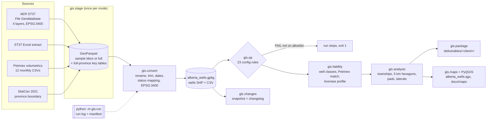
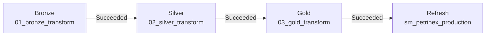
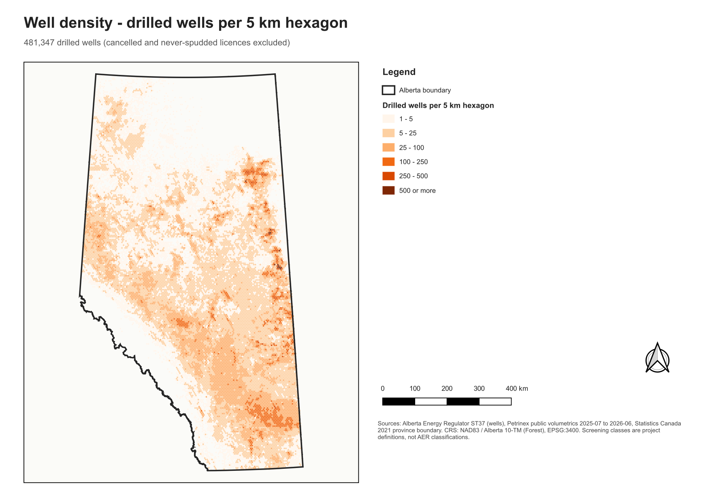
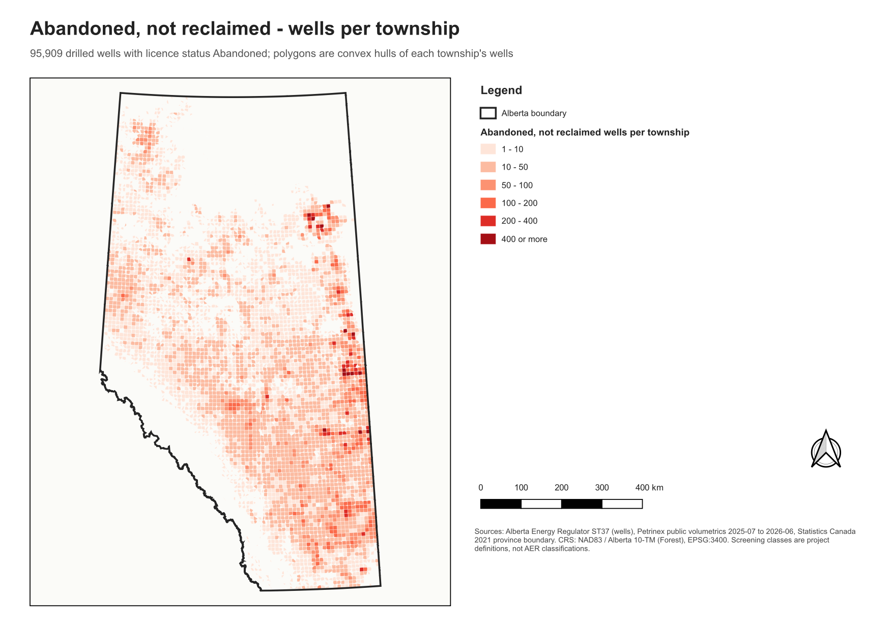
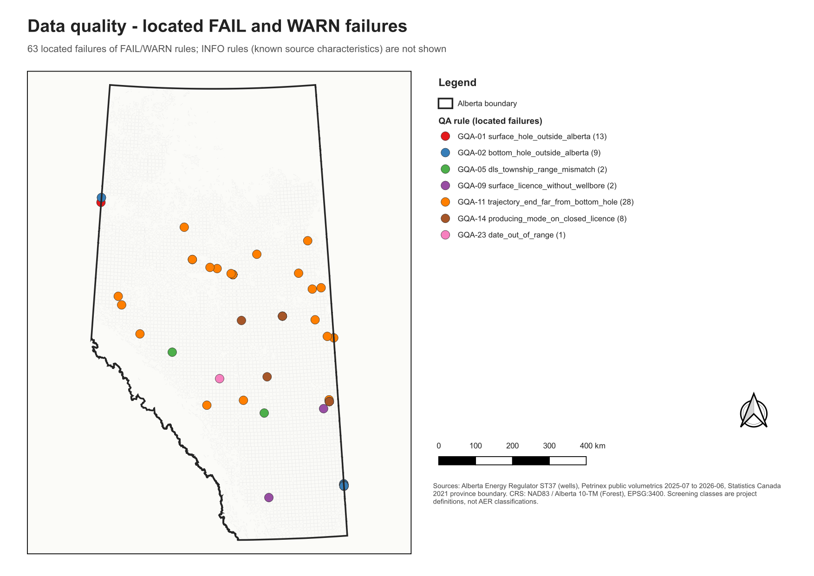
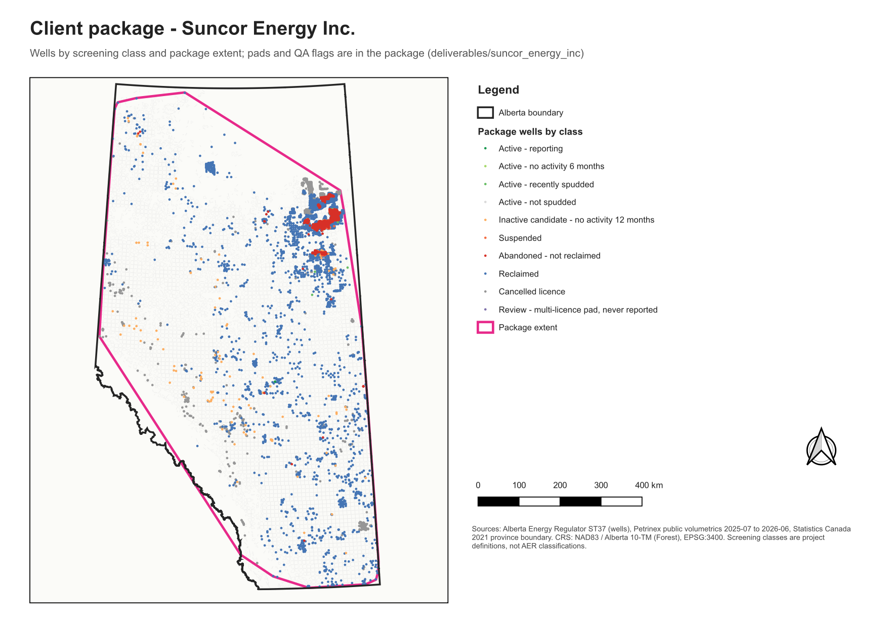

# Alberta Well Production Analytics Platform

[](https://github.com/Mona121212/Alberta-Well-Production-Analytics-Platform/actions/workflows/ci.yml)

Two tracks built on the same public data, plus a PI-style module with simulated sensor readings:

- **Fabric pipeline** (`notebooks/`): Petrinex monthly production and AER well data through a Bronze / Silver / Gold
  medallion architecture in a Microsoft Fabric Lakehouse, feeding a Power BI semantic model.
- **GIS track** (`gis/`, this README): AER ST37 well locations converted, standardized, quality-checked, analysed and
  delivered as client data packages and maps. Local Python (geopandas / pyogrio) plus PyQGIS for cartography.


## Goal

Show the day-to-day work of a GIS analyst on a real, messy provincial dataset (539,890 well licences):
sourcing data, converting and standardizing formats, maintaining mapping layers, checking data accuracy with
repeatable rules, producing client data packages, and supporting decisions with maps.

## Architecture



Every step reads its settings from `config/` (layer and field names, date formats, the licence status mapping table,
QA rules and severities, liability definitions, analysis units, styles, package contents). Sample and full runs write
to separate folders (`gis/output/sample/`, `gis/output/full/`).

## Data sources

| Source | Content used | Date / version | Format | CRS | Licence / terms |
|---|---|---|---|---|---|
| Alberta Energy Regulator, ST37 List of Wells in Alberta | Surface holes, bottom holes, production strings, well trajectories (539,890 licences) | Downloaded 2026-09-29; latest status date 2026-09-02 | File Geodatabase (also Shapefile and Excel) | NAD83 / Alberta 10-TM (Forest), EPSG:3400; lat/long NAD83 (EPSG:4269) | AER public data, subject to AER terms of use |
| Petrinex public data, Alberta volumetrics | Monthly well volumes by activity and product (4,248,675 well rows) | 2025-07 to 2026-06 | CSV (`Vol_YYYY-MM-AB.CSV`) | none (UWI / DLS keys) | Petrinex public data terms |
| Statistics Canada, 2021 Census cartographic boundary file, provinces | Alberta boundary (PRUID 48) | 2021 census, file dated 2021-12 | Shapefile | NAD83 / Statistics Canada Lambert, EPSG:3347 | Statistics Canada Open Licence |

Raw files live in `data/raw/` and are not in Git. The GDB is read once into GeoParquet (`gis.stage`); every later
step reads Parquet or the standardized GeoPackage.

## How to run

```bash
pip install -r requirements.txt
python -m gis.run --mode sample          # whole track on a Calgary-region sample (about 1-2 minutes)
python -m gis.run --mode full            # whole province (about 8-10 minutes)
python -m pytest tests                   # GIS rule tests, defect log, Power BI and pipeline file checks
```

GitHub Actions (`.github/workflows/ci.yml`, DEC-031) runs on every push and pull request with Python 3.12
(`.python-version`): it installs `requirements.txt`, runs `python -m pytest tests` and
`python scripts/build_defect_log.py --check`. It needs no Fabric credentials and no files in `data/`; the Fabric side
is checked by the pipeline's own DQ rule tests and reconciliation tests.

`gis.run` writes `gis/output/<mode>/run_log.txt` and `run_manifest.json` (git commit, per-step status and runtime, row
counts per layer, QA summary, reconciliation results). Single steps: `python -m gis.<step> --mode sample`
for `stage`, `convert`, `qa`, `liability`, `analysis`, `maps`; plus:

```bash
python -m gis.package --mode full --licensee "Suncor Energy Inc."   # or --townships 076-06W4,095-06W4 or --aoi aoi.gpkg
python -m gis.package --mode full --top-licensees 3
python -m gis.changes snapshot --mode full --date 2026-10-22       # after each ST37 refresh
python -m gis.changes compare --old gis/output/snapshots/full/wells_2026-10-22.parquet --new gis/output/snapshots/full/wells_<next>.parquet
python -m gis.changes demo --mode sample                           # synthetic second snapshot with known changes
```

Maps need a local QGIS (path in `config/gis_maps.yaml`); without it `gis.run` skips the maps step with a warning.

### Fabric pipeline

The entry point is the Data Pipeline `pl_well_production_monthly` in the `well-production-mvp` workspace (Lakehouse
`alberta_wells`, DEC-029). Its definition is in `fabric/pl_well_production_monthly.DataPipeline/`; the workspace,
notebook, model and connection IDs it uses are in `config/fabric_items.json`.



| Order | Activity | Runs | Writes | Timeout |
|---|---|---|---|---|
| 1 | Bronze | `01_bronze_transform` | `bronze_petrinex_vol`, `bronze_st37_production_string`, `bronze_st37_bh`, `pipeline_run_log` | 1 h |
| 2 | Silver | `02_silver_transform` | `silver_dim_well`, `silver_petrinex_vol`, `silver_petrinex_vol_flagged`, `dq_results`, `rejected_records`, `dq_rule_test_results`, `dq_month_coverage`, `dq_run_log` | 1 h |
| 3 | Gold | `03_gold_transform` | `gold_dim_well`, `gold_fact_production`, `gold_dim_date`, `gold_dim_operator`, `gold_idle_wells`, `reconciliation_results` | 1 h |
| 4 | Refresh | semantic model refresh of `sm_petrinex_production` (waits for the refresh to finish) | the Direct Lake model | 30 min |

Each activity runs only if the one before it **succeeded**; there are no Failed or Completed branches. Each activity
is retried once after 300 seconds, mainly for HTTP 430 (`TooManyRequestsForCapacity`) on the trial capacity; the
notebooks overwrite their data tables, so a retry does not duplicate rows (DEC-029). A step that fails twice stops
the run and the pipeline shows as Failed. Each notebook raises on its own failures: 01 if a file
fails to load or its row count does not match, 02 if a DQ rule test fails, 03 if a reconciliation test fails
(DEC-022).

Run it (about 23 minutes for the 12 months):

```text
fab job run "well-production-mvp.Workspace/pl_well_production_monthly.DataPipeline" --timeout 10800
```

or open the pipeline in Fabric and select **Run**. Run history: **Monitor** in the left bar of the Fabric portal,
filter on item type *Data pipeline* and `pl_well_production_monthly`; open a run to see each activity's status,
duration and error, and the notebook's Spark snapshot from the Bronze, Silver or Gold activity. Each notebook also
writes its own run log (`pipeline_run_log`, `dq_run_log`, `reconciliation_results`).

**Schedule: off.** The pipeline reloads the files already in `Files/raw/`; it does not download new Petrinex or ST37
files, so a monthly schedule would only rerun the same data. The rule for a 13th month is not decided yet either:
the project keeps 12 months (MoM and rolling 3-month measures, no YoY), and dropping the oldest month or keeping 13 is
a design choice still to make. To turn it on once both are in place: open the pipeline, **Schedule** > **On**,
repeat **Monthly**, pick a day after Petrinex publishes the month, time zone *Mountain Time*, **Apply**. Record the
schedule in DECISIONS.md.

**Debugging.** A single notebook can still be run on its own, for example
`fab job run "well-production-mvp.Workspace/02_silver_transform.Notebook"`. `01_bronze_transform` has one parameter,
`ONLY_SOURCE` (default `None`, every source); `-P ONLY_SOURCE:string=petrinex_vol` reloads one source. A reloaded
file replaces its own rows in one Delta commit (`replaceWhere` on `_source_file`).

`03_gold_transform` reads only Lakehouse tables. It takes the reject and in-scope flags and the run ID from
`silver_petrinex_vol_flagged` (DEC-021) and stops if that table is out of date. `load_defect_log` is not in the
pipeline: it only runs after `config/defect_log.yaml` changes (below). `explore_raw` is read-only exploration.

To change the pipeline, edit `fabric/pl_well_production_monthly.DataPipeline/pipeline-content.json`, run
`python -m pytest tests/test_fabric_pipeline.py`, then:

```text
fab import "well-production-mvp.Workspace/pl_well_production_monthly.DataPipeline" -i fabric/pl_well_production_monthly.DataPipeline -f
fab export "well-production-mvp.Workspace/pl_well_production_monthly.DataPipeline" -o <tmp> -f   # copy the files back into fabric/
```

The defect log has one source, `config/defect_log.yaml` (DEC-024). After editing it:

```text
python scripts/build_defect_log.py            # rebuild the table in docs/defect_log.md
python scripts/build_defect_log.py --check    # table and yaml metrics match the Markdown
fab cp config/defect_log.yaml "well-production-mvp.Workspace/alberta_wells.Lakehouse/Files/config/"
fab job run "well-production-mvp.Workspace/load_defect_log.Notebook"
```

A failed test stops the run (DEC-022): `02_silver_transform` stops if a DQ rule test fails, `03_gold_transform` stops
if any reconciliation test fails or if the 02 run that wrote the flags did not finish. Results are stored before the
error, in `dq_rule_test_results` and `reconciliation_results`.

Silver rule settings are in `config/silver.json`, uploaded like the other config files
(`fab cp config/silver.json "well-production-mvp.Workspace/alberta_wells.Lakehouse/Files/config/"`). It sets how
`hours_above_month_max` gets the maximum hours of a month: `max_of_calendar_and_clock` takes the larger of days x 24
and the clock hours in America/Edmonton (721 in November 2025, 744 in March 2026), so both reporting habits pass
(D-010, DEC-030).

`gold_fact_production` is partitioned by `production_month`, one file per month (DEC-023).

## Power BI dashboard

`well_production_dashboard` reads the semantic model `sm_petrinex_production` (Direct Lake on the Gold and DQ
tables). Both live in the repo: the model as TMDL in `powerbi/sm_petrinex_production.SemanticModel/`, the report as
PBIR in `powerbi/well_production_dashboard.Report/` (DEC-025). The dashboard has two users: asset and operations teams
at Alberta producers, who pick their company and compare it with peers, and the data team, who decides whether a
month can be published (DEC-026).

**Production Performance** - is production rising or falling, and where is the drop? Latest month oil, gas and
condensate with MoM, 12-month trends with the 3-month average, water cut of oil wells and uptime, and the 10 operators
and 10 wells with the largest drop, last 3 months against the 3 before. Supports the decision which operator or well
to look at first.


**Well Activity & Idle Wells** - which wells stopped producing, and which could become a liability? Wells added and
dropped per month, recently idle wells (3+ months without oil, gas or condensate) by operator, and the list ranked by
pre-idle volume, with a flag for wells that reappear under another operator. Supports the decision which idle wells
to review first, and whether a drop is a shut-in or a transfer. The per-well logic is computed in 03_gold_transform
(`gold_idle_wells`, DEC-027).


**Data Trust** - can this month's data be published? Reconciliation status, months loaded, Silver rows, reject rate,
open defects, freshness, run history, the high-severity defects that are not closed, the DQ rules of the latest run,
the reconciliation tests and the defect log. Supports the decision to publish the month or hold it.


Every measure has a description and a display folder (a test checks this). Each new measure was computed a second
time with Spark SQL on the Lakehouse and compared value by value with DAX (38,396 values); `gold_idle_wells` matches
an independent Spark result in all 28,140 values. Not in the dashboard on purpose: revenue (no prices in the data),
YoY and decline curves (12 months only), sums across products (gas e3m3, liquids m3) and the AER 12-month inactive
well definition (DEC-026).

Deploy after editing the files, and export again after a change made in the workspace:

```text
fab import "well-production-mvp.Workspace/sm_petrinex_production.SemanticModel" -i powerbi/sm_petrinex_production.SemanticModel -f
fab import "well-production-mvp.Workspace/well_production_dashboard.Report" -i powerbi/well_production_dashboard.Report -f
fab export "well-production-mvp.Workspace/well_production_dashboard.Report" -o <tmp> -f   # then copy back to powerbi/
```

After a model import, refresh the semantic model so Direct Lake picks up the new definition.

## PI-style sensor module (simulated)

> **Simulated data, PI-style.** Every sensor reading in this module is generated by `sensor/` in this repository. It
> borrows the core concepts of an industrial historian such as AVEVA PI System (tags, an asset hierarchy, quality
> flags, UTC timestamps, event frames), but it is **not AVEVA PI System** and uses no PI software or PI data (DEC-032).

40 real wells from `gold_fact_production` (8 reporting facilities, 20 oil and 20 gas wells with volume in 2025-11)
get five simulated tags each: tubing pressure, casing pressure, wellhead temperature, oil or gas flow rate and run
status. The month is 2025-11, which has 721 local hours in Alberta (daylight saving time ends on Nov 2, see D-010);
timestamps are stored in UTC. All settings, including the selected wells, the tags and units, the ranges, the
deliberate bad readings and the random seed, are in `config/sensor.json`.

**What is real and what is not.** The monthly volumes the sensors are reconciled against are the real Petrinex
volumes of these wells. The hourly readings are simulated so that each well's sensor volume equals its Petrinex
volume within 1%, except for **3 anomaly wells that are set on purpose in `config/sensor.json`** (+15%, -20%, +25%).
Reconciliation flags exactly those three; the tests check that the detection logic catches them. It is not a
finding about the real data.

| PI concept | This project |
|---|---|
| PI Point (tag) and its engineering units | `tag_name` (`<facility>.<well>.<code>`), `unit` in `sensor_asset_hierarchy` |
| AF element hierarchy and attributes | `sensor_asset_hierarchy`: facility -> well -> tag, AF style paths such as `\PI-style\Alberta\ABBT0053340\100011203902W400\|Casing Pressure` |
| PI Data Archive | `bronze_sensor_backfill` (2025-11 hourly history), later `bronze_sensor_readings` (stream) and `silver_sensor_readings` |
| Value quality and digital states (No Data, bad input) | Quality flag Good / Questionable / Bad: missing or outside the physical range is Bad, outside the normal range or frozen is Questionable; flagged, never deleted |
| Event frames | `gold_downtime_events` (stage 3): one row per shut-in, with duration and lost volume |
| Summary calculations / Asset Analytics | `gold_sensor_hourly` (stage 3): hourly values from Good readings only |
| PI interface / connector | `scripts/sensor_simulator.py` via Fabric Eventstream (stage 2) |

Stage 1 (this part) builds the configuration, the well selection, the asset hierarchy and the 2025-11 hourly
history (143,960 readings: 40 wells x 5 tags x 721 hours, minus 240 deliberately missing):

```text
fab job run "well-production-mvp.Workspace/sensor_select_wells.Notebook"     # only when the selection changes
python scripts/sensor_backfill.py                                           # writes data/sensor/ (not in Git)
fab cp data/sensor/backfill_2025-11.parquet "well-production-mvp.Workspace/alberta_wells.Lakehouse/Files/raw/sensor/"
fab cp data/sensor/sensor_asset_hierarchy.parquet "well-production-mvp.Workspace/alberta_wells.Lakehouse/Files/raw/sensor/"
fab cp config/sensor.json "well-production-mvp.Workspace/alberta_wells.Lakehouse/Files/config/"
fab job run "well-production-mvp.Workspace/sensor_load_backfill.Notebook"
```

`sensor_load_backfill` checks keys, uniqueness, the month bounds, the 721 hours and that every tag and well exists
before it writes; failed rows go to `sensor_load_rejects` and the notebook stops with Bronze unchanged.

Stage 2 adds the live feed: `scripts/sensor_simulator.py` sends one reading per tag per minute to the Eventstream
`es_sensor_readings` (custom endpoint source), which writes JSON events to `bronze_sensor_readings`. About 1% of the
readings arrive late and 1% arrive twice, on purpose and without a flag, for Silver to handle. The definition is in
`fabric/es_sensor_readings.Eventstream/`, and a test checks it holds no secret. The connection string is read only from
the environment variable `SENSOR_EVENTHUB_CONNECTION_STRING`; it is never printed or stored. Activate the source and
destination before a run and deactivate them afterwards.

```text
python scripts/sensor_simulator.py --dry-run --duration-minutes 15            # plans the run; sends nothing
python scripts/sensor_simulator.py --duration-minutes 15                      # writes data/sensor/stream_runs/ (not in Git)
fab cp data/sensor/stream_runs/<file>.json "well-production-mvp.Workspace/alberta_wells.Lakehouse/Files/raw/sensor/stream_runs/"
fab job run "well-production-mvp.Workspace/sensor_check_stream.Notebook"      # a few minutes after the last send
```

`sensor_check_stream` reconciles the run's manifest with Bronze (rows, distinct keys, duplicates, late rows, sum of
values) and raises on any difference. The first 15 minute run sent 3,030 events and Bronze holds 3,030: 3,000 unique
readings, 30 duplicates, 30 late. Stages 3 and 4 (Silver and Gold with event frames and reconciliation, and a Power BI
page) follow.

## Outputs

| Output | Content |
|---|---|
| `gis/output/<mode>/alberta_wells.gpkg` | Standardized layers in EPSG:3400: `wells_surface`, `bottom_holes`, `production_strings`, `well_trajectories`, `alberta_boundary`; wells also as Shapefile and CSV |
| `.../qa/` | `qa_defect_log.csv` (the six core columns of the Lakehouse `defect_log`), rule summary, all failures, 5 examples per rule, licensee scorecard, `qa_results.gpkg` (one layer per rule + `wells_qa`) |
| `.../liability/` | `liability.gpkg` (`wells_liability`, `abandoned_not_reclaimed`, `inactive_candidates`, `abandoned_by_township`) and CSV summaries |
| `.../analysis/` | `analysis.gpkg` (`townships`, `hexagons_5km`, `pads`, `wellbore_laterals`) and CSV summaries |
| `deliverables/<client>/` | Client package: `data.gpkg` with embedded QGIS styles, `wells.csv`, `data_dictionary.md`, `README.md`, `.qml` per layer |
| `gis/alberta_wells.qgz`, `docs/maps/` | QGIS project with print layouts, and the exported maps |

## Data quality approach

Rules are data, not code: each entry in `config/gis_qa.yaml` names a generic check, the layer, a severity and
parameters. FAIL rules stop the run on any failure that is not on the rule's `allowlist` of reviewed exceptions (each
entry is a licence number with a written reason; GQA-01 lists the 13 known border wells), after all outputs are
written. WARN rules count against a well in the scorecard, INFO rules document known source characteristics. Results use the six core
`defect_log` columns, and every rule has a constructed-row test (a meta-test fails if a check has none).

Inject a bad row and the run stops:

```text
$ python -m gis.run --mode sample --inject-bad-row
WARNING gis.qa: Injected one bad well (INJECTED) into wells_surface for the stop demo
INFO gis.qa: GQA-01 surface_hole_outside_alberta                  FAIL  1 of 3,300 failed
INFO gis.qa: GQA-03 surface_latlong_mismatch                      FAIL  1 of 3,300 failed
INFO gis.run: Step qa         stopped      8.9 s
INFO gis.run: Run fab9dd3f stopped in 9 s; manifest: gis/output/sample/run_manifest.json
$ echo $?
1
```

The injected well keeps its lat/long but its geometry is moved 50 km outside Alberta; both GQA-01 (outside Alberta,
not on the allowlist) and GQA-03 (geometry vs NAD83 lat/long) fail and stop the run, and liability, analysis,
packages and maps never run on bad data.

## Key findings (full province)

**Data quality** (23 rules, 539,890 wells): 539,846 wells (99.99%) pass every FAIL and WARN rule.
- 13 surface holes along the 110 W / 120 W borders lie 110-571 m outside the StatCan boundary while their lat/long and
  DLS labels agree; each is allowlisted by licence number with a reason (DEC-015). Any other well outside Alberta
  stops the run.
- Geometry matches the NAD83 lat/long attributes for all 1.08 million surface and bottom holes (GQA-03/04).
- DLS labels: only 2 surface holes fall more than a quarter township/range outside their labelled cell.
- 28 trajectories end more than 50 m from their bottom hole (up to 4.5 km); 8 production strings report a producing
  mode on an abandoned or reclaimed licence; 1 licence has a status date in 2030.
- `SHAPE_Length` is 2D: 341,799 "zero-length" trajectories are vertical wells, not empty geometry (DEC-011).
- `Status_Mode` mixes 495,586 numeric codes with 162,680 text values, and the Excel extract decodes them inconsistently.

**Liability screening** (project definitions, not AER criteria, DEC-012):
- 95,971 abandoned-not-reclaimed wells; most held by Canadian Natural (25,661), Cenovus (6,712), Suncor (2,192).
- 17,445 active licences with no production, injection or disposal in 12 months, plus 63,959 suspended; 421 licences on
  large never-reported pads are kept apart for review (DEC-014).
- Petrinex-to-ST37 match: 99.994% of 144,255 producing wells; June 2026 reconciles exactly with the Fabric pipeline
  (161,098 well keys, 135,154 producing).

**Spatial patterns**:
- 481,347 drilled wells on 382,090 surface pads; 42,537 multi-well pads hold 29.5% of wells; the largest has 137 licences.
- Horizontal wellbores (surface-to-bottom-hole offset >= 500 m): 0.5% of 1980 spuds, 51.7% in 2012, 91.5% in 2024; the
  median horizontal offset grew from 646 m (1960) to about 1.9 km.

## Maps

| | |
|---|---|
|  |  |
|  |  |

## Known limitations

- **Approximate townships and DLS check (no ATS layer).** The repository has no Alberta Township System survey layer.
  The DLS label check (GQA-05/06) compares each well against a calibrated approximate grid built from meridians and a
  mean township height (DEC-010): the township/range check is reliable to a quarter cell, but the section check is
  INFO only (1,041 of 539,890 wells flagged): correction-line jogs and road allowances put the approximation off by
  up to about half a section, and LSD is not checked. Township polygons in the analysis are convex hulls of each
  township's surface holes, or 250 m buffers where a township has fewer than 3 or collinear wells (DEC-016):
  they show where wells are, not the legal township boundary, and their areas are not survey areas.
- **Status codes are not decoded.** `Status_Mode` / `Status_Fluid` in production strings mix 495,586 numeric codes
  with 162,680 text values, and the code-to-text pairs in the ST37 Excel extract conflict with each other
  (DEC-011). Without an official AER code table the codes are kept as-is; screening uses the licence status and
  Petrinex activity instead.
- **Change detection is tested only on a synthetic snapshot.** Only one ST37 release has been downloaded. `gis.changes`
  finds all 17 changes injected into a constructed second snapshot (new, removed, status, licensee, moved) with no
  false positives, but it has not run on two real releases. It tracks surface-hole licences only, not bottom holes or
  production strings (DEC-018).
- **Screening classes are project definitions, not AER criteria.** "Abandoned not reclaimed", "no activity 12 months",
  "pad review" and the other classes are working definitions for this project (DEC-012, DEC-014). They are not the
  AER's inactive-well, Licensee Capability Assessment or closure-spend criteria and do not state any regulatory status
  or liability amount.
- **Border wells checked against a cartographic boundary.** GQA-01 uses the StatCan 2021 cartographic boundary; the 13
  border wells allowlisted in `config/gis_qa.yaml` are explained by boundary data vs survey but were not checked
  against an authoritative legal boundary (DEC-015).
- Petrinex covers 12 months; inactivity cannot look further back, and volumes are not converted between units (gas
  e3m3, liquids m3).
- Maps need a local QGIS install; staging, QA, analysis and packages do not.

## Repository guide

- `notebooks/` - Fabric notebooks: `01_bronze_transform`, `02_silver_transform`, `03_gold_transform`, plus
  `load_defect_log` and `explore_raw`; PI-style sensors: `sensor_select_wells`, `sensor_load_backfill`
- `sensor/` - PI-style simulated sensors (DEC-032): config and UTC hour grid, asset hierarchy, backfill generator,
  quality flags, reconciliation estimate; `scripts/sensor_backfill.py` writes the backfill files
- `gis/` - pipeline modules (`stage`, `convert`, `qa`, `qa_checks`, `liability`, `analysis`, `package`, `changes`,
  `maps`, `qgis_maps`, `run`)
- `config/` - every setting, rule, mapping table, field dictionary and style
- `.github/workflows/ci.yml` - CI: pytest and the defect log check on every push and pull request (DEC-031)
- `powerbi/` - semantic model (TMDL) and dashboard (PBIR), deployed with `fab import` (DEC-025)
- `fabric/` - Data Pipeline `pl_well_production_monthly` (Bronze -> Silver -> Gold -> model refresh), deployed with
  `fab import` (DEC-029)
- `tests/gis/` - rule and module tests; `tests/test_defect_log.py` - defect log in sync with its yaml source;
  `tests/test_powerbi_files.py` - no credentials in `powerbi/`, every measure documented;
  `tests/test_fabric_pipeline.py` - pipeline order, Succeeded-only dependencies, target items, no credentials;
  `tests/test_silver_config.py` - month hour limit of `hours_above_month_max` (D-010);
  `tests/test_sensor_backfill.py` - sensor config, 721 hours, hierarchy, generator, quality flags, reconciliation
- `docs/` - `progress.md`, `final_report.md`, `st37_gis_exploration.md`, `defect_log.md`, maps, dashboard screenshots
- `DECISIONS.md` - Context / Decision / Alternatives / Consequences for every design choice (DEC-001 to DEC-032)
