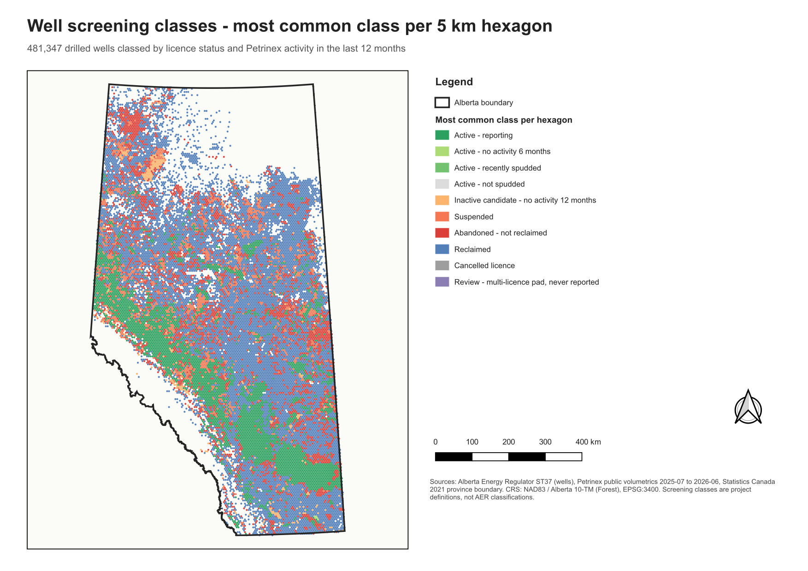
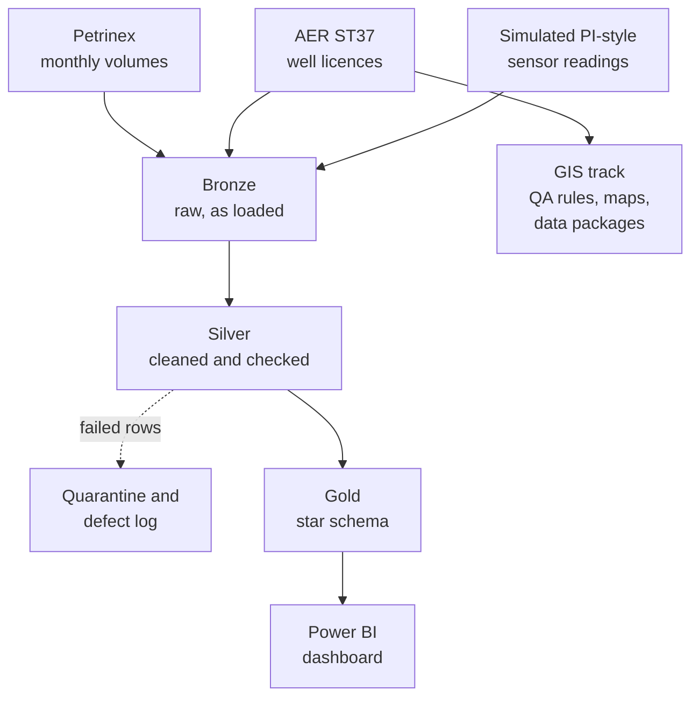
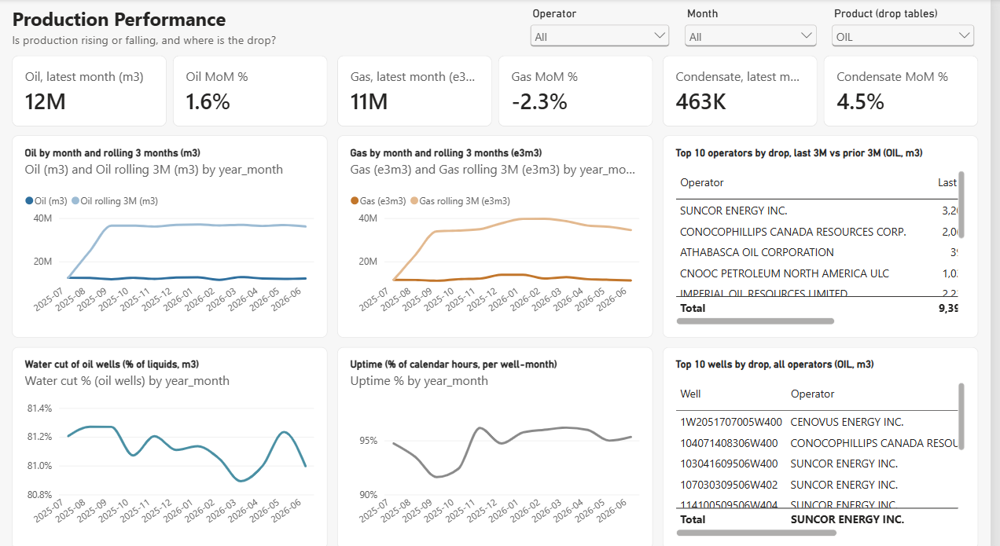
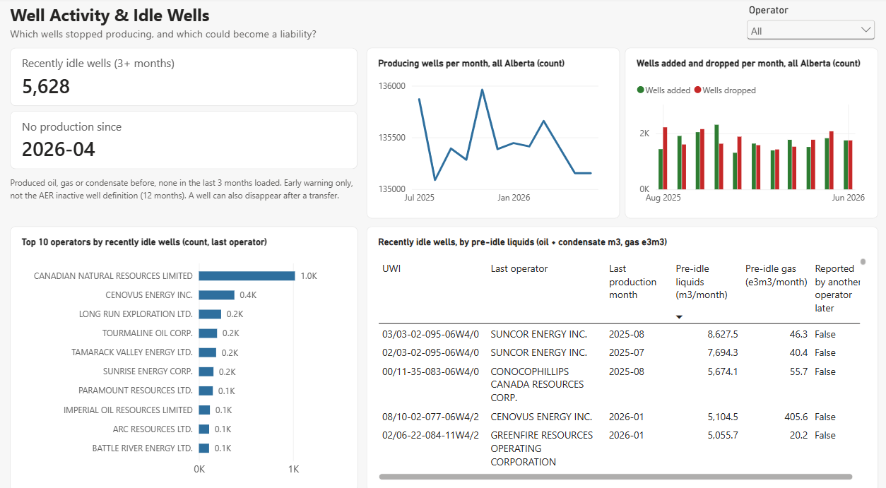
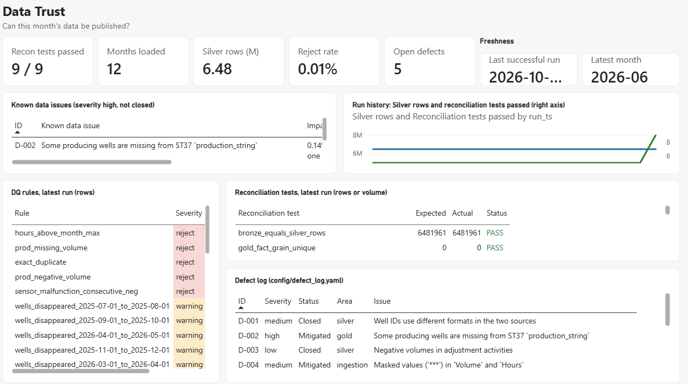
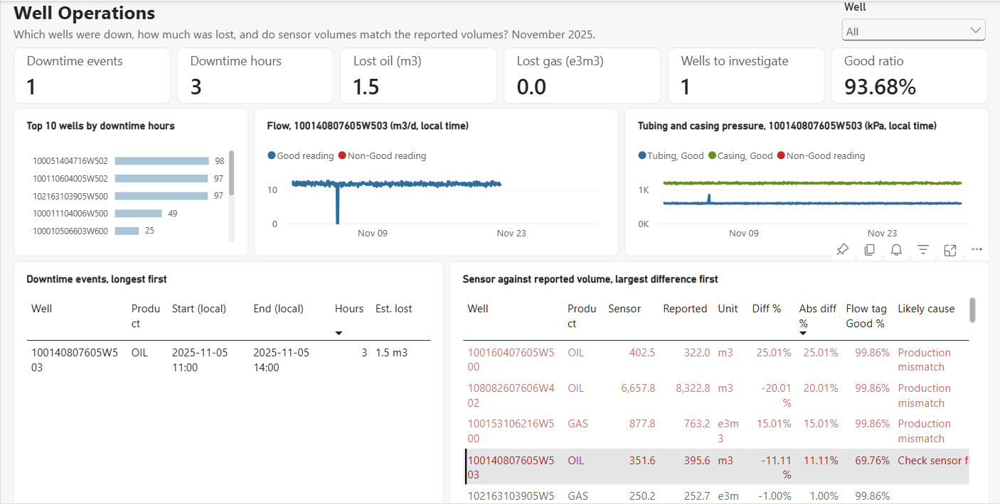
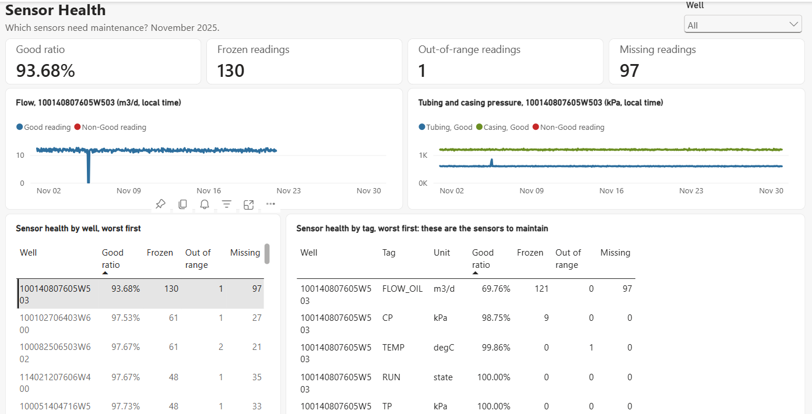

# Alberta Well Production Analytics Platform

[](https://github.com/Mona121212/Alberta-Well-Production-Analytics-Platform/actions/workflows/ci.yml)

Public Alberta oil and gas data, turned into numbers people can trust: a Microsoft Fabric pipeline and Power BI
dashboard for 12 months of well production, a GIS track that checks every AER well licence, and a module with
simulated, PI-style sensor readings.

- **6,481,961** Petrinex production rows (2025-07 to 2026-06), checked by rules before they reach the dashboard
- **539,890** AER well licences checked against 23 location and attribute rules
- **99.7%** of Petrinex well IDs matched to the AER after normalizing two different formats
- **376,518.5 m3** of November 2025 oil recovered after finding a daylight-saving bug



## Who this is for

This is a personal portfolio project built on public data. It is designed for three kinds of users:

- **Asset and operations teams at Alberta producers** decide which operator or well to look at first when production
  drops, and which idle wells to review before they become a liability.
- **Data teams** decide whether a month of data can be published or must be held until a problem is fixed.
- **Production engineers** decide whether a gap between metered and reported volume is a sensor to fix or a
  production problem to investigate (sensor module, simulated data).

## The problem

- **Two separate sources.** Production volumes come from Petrinex, and well licences and locations from the Alberta
  Energy Regulator (AER).
- **Well IDs do not match.** Petrinex writes `100010206504W400`, the AER writes `00/06-06-001-01W4/0`, so a direct join
  matches nothing.
- **Data must be checked before it is trusted.** The files contain masked values, padded text and adjustment rows
  with negative volumes.
- **Monthly data changes after it arrives.** Late submissions make a single month noisy, and a reloaded file must
  replace its own rows without duplicating them.
- **Idle wells are a liability.** A well that stops producing still has to be suspended, abandoned and reclaimed.
- **Sensor readings must agree with reported production.** If the volume a meter implies differs from what was
  reported, someone has to find out why.

## What I built



- **Bronze** keeps every source file as loaded, so any number can be traced back to its file.
- **Silver** cleans, standardizes and checks the data with configurable rules; rows that fail go to a quarantine table.
- **Gold** is a star schema (production fact, well, operator and date dimensions, plus a table of idle wells).
- **Power BI** reads Gold directly through a Direct Lake semantic model; the model and report are files in this repo.
- **A Fabric Data Pipeline** runs Bronze, Silver, Gold and the model refresh in order and stops at the first failure.
- **The GIS track** standardizes the AER well layers, checks them with 23 rules, and produces maps and data packages.
- **The sensor module** simulates hourly readings for 40 real wells and reconciles them with their real reported
  volumes. The readings are simulated and PI-style: this is not AVEVA PI System.

## Results

| What was verified | Result | Source |
|---|---|---|
| Petrinex well IDs matched to the AER | 99.7% (166,433 of 166,901) | [D-001](docs/defect_log.md) |
| November 2025 oil recovered after the daylight-saving fix | 376,518.5 m3 in 152 rows (3.06% of the month) | [DEC-030](DECISIONS.md) |
| Pipeline tests in the latest monthly run | 11 of 11 rule tests and 9 of 9 reconciliation tests pass | [DEC-030](DECISIONS.md) |
| AER well licences passing every blocking and warning rule | 539,846 of 539,890 (99.99%) | [Technical reference](docs/TECHNICAL.md#key-findings-full-province) |
| Data read for a one-month query after partitioning | 43.9 MB to 3.7 MB (files read 10 to 1) | [DEC-023](DECISIONS.md) |
| Idle well list load time | 39.1 s to well under 1 s | [DEC-027](DECISIONS.md) |
| Dashboard measures recomputed in Spark and compared with Power BI | 38,396 values | [DEC-026](DECISIONS.md) |

## Dashboard

Five pages, one question each.

**Production Performance**: is production rising or falling, and where is the drop? It helps decide which
operator or well to look at first.



**Well Activity & Idle Wells**: which wells stopped producing, and which could become a liability? It helps decide
which idle wells to review first, and whether a drop is a shut-in or a transfer to another operator.



**Data Trust**: can this month's data be published? It shows the test results, open defects and run history, to
decide whether to publish the month or hold it.



**Well Operations** (simulated sensor data): which wells were down, how much was lost, and do sensor volumes match
the reported volumes? It helps a production engineer decide which well to look at first, and whether to check the
sensor or production.



**Sensor Health** (simulated sensor data): which sensors need maintenance? It helps decide which well and tag to
service first.



## What I found

**99.7% of well IDs matched, but the few missing wells carried 2.48% of the gas.** Only 446 of 144,259 producing wells were missing
from the AER production strings, just 0.14% of the rows. They carried 2.48% of the gas volume over 12 months, and 7.1%
in June 2026, so they are kept rather than dropped, and the growing gap is logged as an open defect (D-009).

**A daylight-saving bug hid 3% of November's oil.** A rule rejected any row reporting more hours than days x 24, but
November 2025 has 721 clock hours in Alberta. It kept 152 oil rows (376,518.5 m3) out of the dashboard, and November's oil
change showed -3.98% instead of -0.95%. The rule now uses the larger of days x 24 and the real clock hours.

**4 of 5,628 idle wells were transfers, not shut-ins.** A well that stops reporting under one operator can reappear
under another. The idle list flags these wells, so a transfer is not mistaken for a shut-in or a production drop.

**A faulty meter and a real production gap look the same until you check the sensor (simulated).** All sensor data is
simulated, and these faults are injected on purpose. Three wells were given volumes +15%, -20% and +25% off their real
reported volumes with healthy sensors; one well's flow meter was frozen for 120 hours and dropped out for 96 while the
true rate ran 1.4 times higher, so its sensor volume came out -11.11%. Reconciliation flags all four, and `likely_cause`
tells them apart: the fault well's flow tag is only 69.76% Good, below the 80% threshold, so it says "Check sensor
first", while the other three say "Production mismatch". Two aging meters at 89.88% and 90.71% Good still reconciled
within 0.5% (+0.47% and +0.14%), which is why the threshold sits at 80%.

## How the data is kept trustworthy

- **A failed test stops the run.** Each step checks its own output and stops the pipeline before bad data reaches
  the dashboard (DEC-022).
- **Reconciliation between layers.** Row counts and volume totals must match from Bronze to Gold; the results are
  stored and shown on the Data Trust page.
- **One defect log.** Every data issue found (10 so far) has an ID, impact, handling and status, in a single file that
  feeds both [docs/defect_log.md](docs/defect_log.md) and the dashboard (DEC-024).
- **CI on every change.** GitHub Actions runs the test suite and the defect log check on every push and pull request
  (DEC-031).
- **Refactors proven with Delta time travel.** After a change, the new table is compared with its previous version:
  partitioning the production table changed 0 rows (DEC-023), and the daylight-saving fix changed only November 2025
  (DEC-030).

## Tech stack

- **Microsoft Fabric:** Lakehouse (Delta tables), PySpark and Spark SQL notebooks, Data Pipeline, Eventstream
- **Power BI:** Direct Lake semantic model, DAX, report and model stored as TMDL / PBIR files
- **Python:** pandas, geopandas, pyogrio, shapely, pytest
- **GIS:** PyQGIS print layouts, GeoPackage, EPSG:3400
- **Tooling:** Fabric CLI (`fab`), GitHub Actions

## For engineers

Quick start for the local GIS track and the tests:

```bash
pip install -r requirements.txt
python -m pytest tests                   # GIS rules, defect log, Power BI and pipeline file checks
python -m gis.run --mode sample          # whole GIS track on a Calgary-region sample
```

The Fabric pipeline runs in a Fabric workspace:

```text
fab job run "well-production-mvp.Workspace/pl_well_production_monthly.DataPipeline" --timeout 10800
```

Details are in the [technical reference](docs/TECHNICAL.md):
[how to run](docs/TECHNICAL.md#how-to-run), [Fabric pipeline](docs/TECHNICAL.md#fabric-pipeline),
[Power BI](docs/TECHNICAL.md#power-bi-dashboard), [sensor module](docs/TECHNICAL.md#pi-style-sensor-module-simulated),
[data sources](docs/TECHNICAL.md#data-sources), [data quality](docs/TECHNICAL.md#data-quality-approach),
[known limitations](docs/TECHNICAL.md#known-limitations) and the [repository guide](docs/TECHNICAL.md#repository-guide).

| Folder | Content |
|---|---|
| `notebooks/` | Fabric notebooks for Bronze, Silver, Gold and the sensor module |
| `fabric/` | Data Pipeline and Eventstream definitions |
| `powerbi/` | Semantic model (TMDL) and dashboard (PBIR) |
| `gis/` | GIS track modules |
| `sensor/` | Simulated sensor generator and rules |
| `config/` | Every setting, rule and mapping table |
| `tests/` | pytest suite run by CI |
| `docs/` | Technical reference, defect log, reports, maps, screenshots |

Every design choice is recorded with its context, alternatives and consequences in [DECISIONS.md](DECISIONS.md).
The [defect log](docs/defect_log.md) lists every data issue found. The [GIS final report](docs/final_report.md)
summarizes the GIS track.

**Next steps:** a monthly schedule, once new files are downloaded automatically and the rule for a 13th month is
decided; and the cause of the growing production string gap (D-009).
